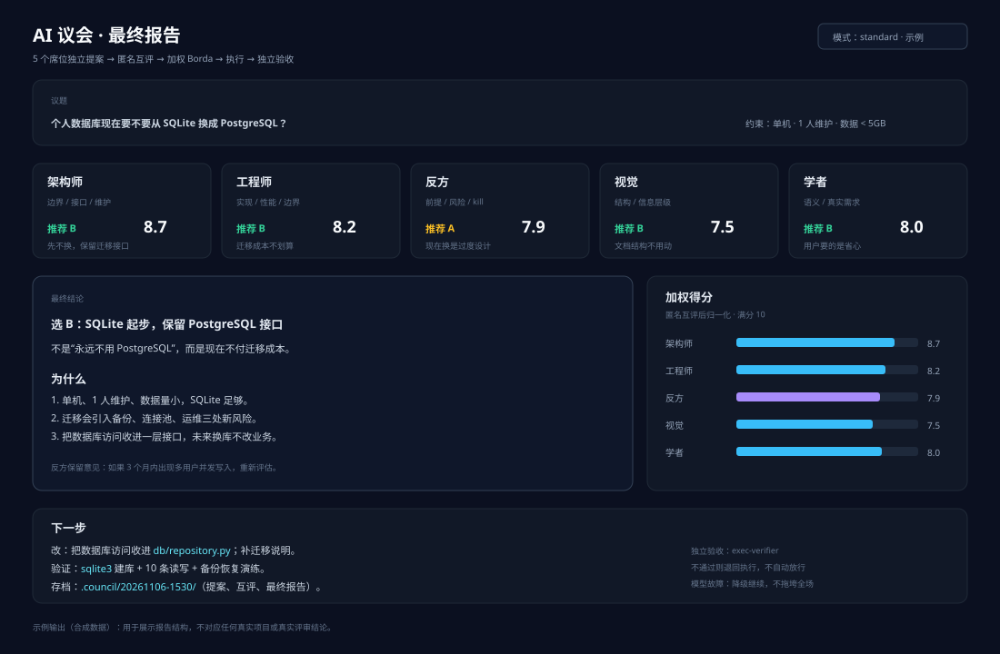

# AI Council · AI 议会 (Multi-Model Discussion Rules)

> **Language / 语言**: [中文](README.md) | English
> **Name / 名称**: AI Council · AI 议会
> **Current version**: [`v0.1.0`](CHANGELOG.md) · [Versioning rules](VERSIONING.md)

> Have 5 subagents in different roles **produce proposals independently → peer-review anonymously → converge by weight → execute → accept independently**.
> Good for: architecture selection, comparing approaches for a complex change, multi-perspective review of writing/design, critic stress-testing before a major decision.
> Not for: questions you can answer in one sentence, pure fact lookups, small changes that must ship right now.
>
> - New to AI? Read this `README`.
> - Want an AI to install it for you? Hand the whole `AI-INSTALL.en.md` to an AI.
> - Rule source files: `command/council.md` + `agents/*.md`.

<p>
  
  
  
  
  
  
</p>

## Project Overview

This is not a software package but a set of **multi-model discussion rules**: 5 subagents in different roles first produce proposals independently, then peer-review each other anonymously, converge by weight, and finally execute and accept the result independently. The core is just a few Markdown files, with no binding to any particular model.

**Who it's for**

- People who have to choose among several architecture options and are afraid of trusting their own first instinct.
- Complex changes, writing, and design reviews that need a "critic" dedicated to tearing down the premises.
- People already using OpenCode (or any AI tool that supports subagents) who want to add a decision process.

**Who it's not for**

- Questions you can answer in one sentence; a meeting is slower than just doing it.
- Pure fact lookups, and small changes that must ship immediately.
- Tools with no subagent capability whose setup you don't intend to extend to multiple models.

**What you get**

| Artifact | Location |
|---|---|
| Human-facing install / usage / cost / boundaries | `README.en.md` (this document) |
| AI install protocol | `AI-INSTALL.en.md` (Chinese: `AI-INSTALL.md`) |
| Main council flow | `command/council.md` |
| 5 seats + independent acceptance | `agents/` |
| How it works, customization, troubleshooting | `docs/` (Chinese) |
| Sample report output | `docs/images/` |
| Version and changelog | `VERSION` / `CHANGELOG.md` / `VERSIONING.md` |

> English scope: this README and `AI-INSTALL.en.md` are complete translations. The optional deep-dive files under `docs/` are currently in Chinese.

**Newcomers: do these 3 steps first**

1. Following section 4, copy `command/` and `agents/` into your own AI tool directory.
2. Following section 5, configure a model for each seat; running everything on the same cheap model works to start with.
3. Try a **small topic** in `quick` mode, confirm the output format and archive location, then turn on the default mode.

---

## Table of Contents

- [1. What It Is](#1-what-it-is)
- [2. The Five Seats](#2-the-five-seats)
- [3. Workflow](#3-workflow)
- [4. Installation](#4-installation)
- [5. Configuring Models](#5-configuring-models)
- [6. Usage](#6-usage)
- [7. Modes and Cost](#7-modes-and-cost)
- [8. What the Output Looks Like](#8-what-the-output-looks-like)
- [9. Customization](#9-customization)
- [10. Troubleshooting](#10-troubleshooting)
- [11. Boundaries and Risks](#11-boundaries-and-risks)
- [Appendix A: File List](#appendix-a-file-list)
- [Appendix B: Minimal Example](#appendix-b-minimal-example)

---

## 1. What It Is

An ordinary AI conversation is "one model answers everything in one pass". The problems:

- It follows its own first instinct;
- It won't actively look for counterexamples to itself;
- It easily mistakes "looks reasonable" for "verified";
- Different models have different blind spots, but you usually use only one.

The council sends the same question to several subagents with **different roles**:

```text
Question
 ├─ Architect: boundaries, interfaces, long-term maintenance
 ├─ Engineer: implementation, performance, edge cases
 ├─ Critic: tear down premises, find failure paths
 ├─ Vision: read images / break down requirements / cross-check
 └─ Scholar: Chinese semantics, what the user actually wants
        ↓
   anonymous peer review (no one knows who wrote what)
        ↓
   weighted Borda convergence
        ↓
   execution + independent acceptance
```

The point is not "more models" but:

1. **Independent proposals**: no mutual influence, no bandwagon effect.
2. **Anonymous peer review**: reduces the bias that "the expensive model must be right".
3. **Critic seat**: dedicated to finding kill criteria.
4. **Independent acceptance**: the executor cannot pass its own work.
5. **Degradation**: if one model dies, it doesn't sink the whole session.

---

## 2. The Five Seats

| Seat | Focus | Typical output |
|---|---|---|
| Architect | System boundaries, interface contracts, dependency direction, maintainability | Structured proposal; will we regret this in three months |
| Engineer | Code implementation, performance, VRAM/RAM, abnormal input, compatibility | A change that can actually land; degraded fallback |
| Critic | Whether the premises hold, hidden risks, failure paths | Objections, KILL CRITERIA |
| Vision | Reading images, color, spatial relations; breaking down requirements when there is no image | HEX, composition, contradictions |
| Scholar | What the user really wants to solve, Chinese qualifiers, long documents | Requirement restatement, ambiguities, sources |

Optional sixth seat (`wide` mode): a general-purpose model from a different vendor, adding a second perspective.

> A seat is not "role-play"; it is a **different checklist**. Models can be swapped; checklist items cannot be dropped.

---

## 3. Workflow

```text
Stage 0  Preparation: check facts, write the context pack, create the archive directory
Stage 1  Parallel independent proposals (≤400 characters per seat)
Stage 2  Anonymous peer review (≤300 characters per seat, with rankings)
Stage 3  Weighted convergence (Borda primary, mean as auxiliary)
Stage 4  Execution + evidence trail + independent acceptance
Stage 5  Degradation / failure loopback (max 3 rounds)
```

### 3.1 Hard Rules

1. **Stay silent throughout**: apart from the final report, do not write "I'm calling…" or "let me look" in the chat.
2. **Never fabricate**: if the subagents were not actually called, "four proposals" must not appear.
3. **Never stall**: if a single seat fails / times out / returns 502, degrade and keep going.
4. **Conclusions only**: final output ≤500 characters; details go to disk.
5. **Evidence first**: any step without raw output counts as not done.
6. **The executor does not judge itself**: acceptance goes to an independent verifier.

### 3.2 When to Use It

Suitable for:

- "Which of architectures A/B/C should this be?"
- "Does this refactor hide any risks?"
- "Help me turn this vague requirement into an actionable plan."
- "How would a critic attack this paper / this design?"
- "After changing the code, review it from several roles before delivery."

Not suitable for:

- "What day is it today?"
- "Rename this variable."
- "Look up the parameters of this API."
- Tasks already specific enough that only mechanical execution is left.

> A council is expensive. **Don't hold a meeting for small things.**

---

## 4. Installation

### 4.1 Prerequisites

- OpenCode is installed and can call at least one model normally.
- A `~/.config/opencode/` directory exists (Windows: `%USERPROFILE%\.config\opencode\`).
- At least 2 usable models/providers (not mandatory, but with only 1 model the council's value drops).

Check:

```bash
opencode --version
opencode models
```

### 4.2 Copy the Files

**Linux / macOS:**

```bash
mkdir -p ~/.config/opencode/commands ~/.config/opencode/agents
cp command/council.md ~/.config/opencode/commands/council.md
cp agents/council-*.md ~/.config/opencode/agents/
cp agents/exec-verifier.md ~/.config/opencode/agents/
```

**Windows PowerShell:**

```powershell
$dst = "$env:USERPROFILE\.config\opencode"
New-Item -ItemType Directory -Force "$dst\commands","$dst\agents" | Out-Null
Copy-Item .\command\council.md "$dst\commands\council.md" -Force
Copy-Item .\agents\council-*.md "$dst\agents\" -Force
Copy-Item .\agents\exec-verifier.md "$dst\agents\" -Force
```

### 4.3 Restart

```bash
opencode service restart
```

Or quit OpenCode and open it again.

### 4.4 Verify

In OpenCode, type:

```text
/council quick test whether the council can start with a simple question
```

Expected:

- You can see subagent calls;
- At the end there is a "seat / core claim" table;
- There are files in the archive directory.

> If `/council` doesn't appear: check that the filename is exactly `council.md` and the directory is `commands/` (not `command/`).

---

## 5. Configuring Models

### 5.1 Why You Need to Change It

This repo **contains no private provider/model names**. After copying it as-is, the agents have no model specified and inherit the current session model — that runs, but all five seats may end up on the same model, which discounts the value.

### 5.2 Where to Change It

At the top of each `agents/council-*.md`:

```yaml
---
description: ...
mode: subagent
# model: your-provider/your-model
permissions:
  ...
---
```

Uncomment `# model:` and put in your own:

```yaml
model: your-provider/your-model
```

The `provider/model` form follows the output of `opencode models`.

### 5.3 How to Assign

| Seat | Suggested choice | Reason |
|---|---|---|
| Architect | Strong reasoning / long context | Sees boundaries, interfaces, long-term maintenance |
| Engineer | Strong coding | Implementation details, edge cases |
| Critic | Different vendor / different style | Avoids same-source blind spots |
| Vision | Multimodal | Can actually read images |
| Scholar | Strong Chinese / long context | Requirement semantics, long documents |
| Acceptance | Strict, cheap, stable | Only runs commands and checks evidence |

**Principles:**

- At a minimum, give the "critic" a model from a **different vendor**; otherwise it tends to echo the same source.
- Don't let the cheapest model write specialized scripts.
- Don't put every seat on the same model.
- Run `quick` first to verify the pipeline, then turn on the default five seats.

### 5.4 If You Don't Want to Configure Multiple Models

You can:

- Configure only 2 models: one strong reasoner + one strong coder; the rest inherit.
- Use `quick` mode (Architect + Engineer).
- Treat the council as a "structured checklist" and don't chase model diversity.

> Model diversity is a bonus, not a prerequisite. **Process and evidence** are the core.

---

## 6. Usage

### 6.1 Basic

```text
/council Should this project use SQLite or PostgreSQL?
```

### 6.2 With a Mode

```text
/council quick check whether this function has edge-case problems
/council wide does this architecture plan miss any risks?
/council show paste the original text from all five seats
```

### 6.3 Against an Existing Proposal

```text
/council poke holes in the proposal from a moment ago
```

The rules record the existing proposal as `P0` and mix it into the candidates anonymously, so council members don't favor it.

### 6.4 With an Image

```text
/council look at this UI screenshot — any problems with color and hierarchy?[image]
```

The Vision seat reads the image; with no image it breaks down the requirements instead.

### 6.5 Parameters

| Parameter | Effect |
|---|---|
| `quick` | 2 seats, proposals only, no peer review, 20–30 s |
| `wide` | default 5 seats + 1 supplementary model |
| `show` | paste each seat's original text into the conversation (by default only conclusions are given) |
| no parameter | default 5 seats + peer review |

---

## 7. Modes and Cost

| Mode | Seats | Stages | Typical duration | Cost magnitude |
|---|---|---|---|---|
| `quick` | 2 | proposals | 20–30s | low |
| default | 5 | proposals + peer review | 60–90s | medium |
| `wide` | 6 | proposals + peer review | 100–130s | medium-high |
| `show` | same as default | same as default | +0 | same as default |

> Cost depends on your model's unit price and context length. The table above gives orders of magnitude, not a quote.
> The council calls models **multiple times**; trim the context first for long documents / large codebases.

### Saving Money

1. Run `quick` first; go default only if it's worth it.
2. Keep the context pack ≤1200 characters; don't stuff the whole repo in.
3. Only let the seats that need it see long material.
4. A cheap model is fine for the peer review stage.
5. Do small things directly; don't hold a meeting.

---

## 8. What the Output Looks Like

First, a sample of the final report: the topic at the top, the five seats' recommendations and weighted scores in the middle, and the conclusion, next steps and archive location at the bottom.



> This image is a **synthetic example** showing the report structure; it does not correspond to any real project or any real review conclusion.

Final report (≤500 characters):

```text
Conclusion: choose B — run SQLite first, keep the interface for switching to PostgreSQL.

| Seat | Recommendation | Weighted score | Position |
|---|---|---|---|
| Architect | B | 8.7 | Enough for a single machine; keep the interface clean |
| Engineer | B | 8.2 | Migration cost is manageable |
| Critic | A | 7.9 | Worried about concurrent writes |
| Vision | B | 7.5 | No image; broke it down from requirements |
| Scholar | B | 8.0 | Users want speed |

Disagreement: the critic worries about multiple writers; decided B + migration conditions.
Changes: docs/architecture.md; db/schema.sql
Verification: create DB with sqlite3 + 10 concurrent write test
Risk: needs re-evaluation above 5k requests/day
Archive: .council/20261106-1530/
```

> By default the five original texts are not pasted; add `show` to get them.
> Seats that dropped out or switched models are marked `(fallback: model-name)`.

---

## 9. Customization

### 9.1 Adding a Seat

Copy `agents/council-critic.md` and change:

- filename: `council-security.md`
- `description`
- role description
- output rules

Then add a row to the seat table in `command/council.md` and mention it in the Stage 1 prompt.

### 9.2 Changing Weights

Change "weight" in the seat table in `command/council.md`. Weights affect:

- the Borda scores in peer review;
- the mean reference.

Suggestion: critic/architect slightly higher, vision/scholar slightly lower; don't spread them too far apart.

### 9.3 Changing the Archive Directory

In `command/council.md`, search for `COUNCIL_DIR` or `.council` and change it to your own path.

Default: `.council/<timestamp>/` under the current working directory.

### 9.4 Changing Acceptance

`agents/exec-verifier.md` handles independent acceptance. You can:

- switch to a stricter model;
- add project-specific check commands;
- require it to paste raw output.

### 9.5 Removing the Execution Stage

If you only want "multiple models giving advice" and no automatic execution:

- delete Stage 4 from `command/council.md`;
- keep Stages 1–3;
- output only the proposal at the end, without landing it.

---

## 10. Troubleshooting

| Symptom | Cause | Fix |
|---|---|---|
| `/council` doesn't appear | file is not in `commands/` | check path/filename |
| Command appears but no subagent is called | agent files not placed correctly | check `agents/council-*.md` |
| Error: model does not exist | wrong `provider/model` in frontmatter | get the exact ID with `opencode models` |
| Five seats give nearly identical answers | all inherit the same model | assign different models to the seats |
| One seat keeps timing out | upstream is unstable | automatic degradation / fallback model |
| No table at the end | the model didn't follow the template | stress the output format in the command |
| Archive directory has no files | permissions / path | change to a directory you can write to |
| Cost exceeds expectations | context too large / `wide` turned on | run `quick` first, trim the material |
| Subagents modified files | permissions not restricted | check the agent's `permissions` |

### 10.1 Minimal Diagnosis

```text
1. opencode --version
2. ls ~/.config/opencode/commands/council.md
3. ls ~/.config/opencode/agents/council-*.md
4. opencode models | grep your-model
5. /council quick test
```

---

## 11. Boundaries and Risks

### 11.1 What It Cannot Do

- Guarantee the conclusion is correct;
- replace real tests;
- replace domain experts;
- automatically fix upstream 502s;
- turn a weak model into a strong one.

### 11.2 What It Will Do

- Cost more money;
- take more time;
- produce "looks comprehensive" fluff;
- fabricate when context is insufficient;
- make simple problems complicated.

### 11.3 Principles of Use

1. **First ask whether the meeting is worth it.**
2. **The context pack must be real**: goals, facts, raw error text, constraints, acceptance.
3. **The critic is not decoration**: its KILL CRITERIA must make it into the final plan.
4. **The executor does not judge itself**: independent acceptance.
5. **Mark uncertainty as uncertainty**: don't let a model hide gaps behind fluent wording.
6. **Don't use the council for illegal or harmful decisions.**

### 11.4 Privacy

- The council sends material to multiple models/providers.
- Don't put in API keys, ID numbers, customer privacy, or undisclosed financial data.
- In a corporate environment, confirm the provider's data policy first.
- Archive files may contain sensitive information; mind permissions / cleanup.

---

## Appendix A: File List

| File | Purpose |
|---|---|
| `command/council.md` | Main flow of the `/council` command |
| `agents/council-architect.md` | Architect seat |
| `agents/council-coder.md` | Engineer seat |
| `agents/council-critic.md` | Critic seat |
| `agents/council-vision.md` | Vision seat |
| `agents/council-scholar.md` | Scholar seat |
| `agents/exec-verifier.md` | Independent acceptance |
| `docs/how-it-works.md` | Flow details |
| `docs/customize.md` | Customization |
| `docs/troubleshooting.md` | Troubleshooting |
| `AI-INSTALL.en.md` / `AI-INSTALL.md` | Install protocol for AI (English / Chinese) |

## Appendix B: Minimal Example

```text
/council quick What happens to this Python function when the input is empty?

def parse(s):
    return s.split(",")[0].strip()
```

Expected:

- Architect: interface boundaries, empty-input contract;
- Engineer: `None` / empty string / type errors, minimal fix;
- Final: conclusion + fix + verification command.

> Start with `quick`; don't open with `wide`. A council is a scalpel, not a hammer.