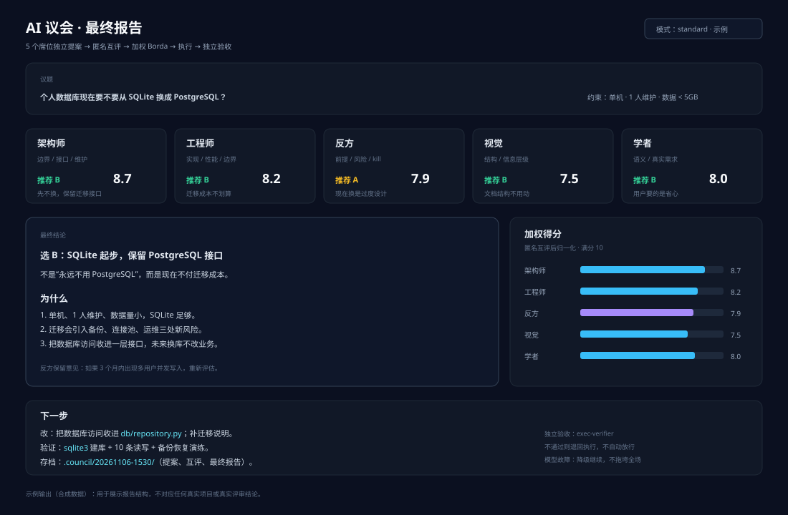

# AI 议会 · AI Council（多模型讨论规则）

> **Language / 语言**: 中文 | [English](README.en.md)
> **名称 / Name**: AI 议会 · AI Council
> **当前版本 / Current version**: [`v0.1.0`](CHANGELOG.md) · [版本规则](VERSIONING.md)
> **工作记录 / Worklog**: [WORKLOG.md](WORKLOG.md)

> 让 5 个不同角色的子代理**独立出方案 → 匿名互评 → 加权收敛 → 执行 → 独立验收**。
> 适合：架构选型、复杂改动的方案对比、写作/设计的多视角评审、重大决策前的反方压力测试。
> 不适合：一句话能答完的问题、纯事实查询、必须立刻交付的小改。
>
> - 不会用 AI？看这份 `README.md`。
> - 想让 AI 帮你装？把 `AI-INSTALL.md` 整个丢给 AI。
> - 规则源文件：`command/council.md` + `agents/*.md`。

<p>
  
  
  
  
  
  
</p>

## 项目简介

这不是一个软件包，而是一套**多模型讨论规则**：5 个角色不同的子代理先独立出方案，再匿名互评，加权收敛，最后执行并独立验收。核心只有几个 Markdown 文件，不绑定具体模型。

**适合谁**

- 要在几个架构方案里做选择，怕自己只看第一直觉的人。
- 复杂改动、写作、设计评审，需要一个“反方”专门拆前提的人。
- 已经在用 OpenCode / 支持子代理的 AI 工具，想加一套决策流程的人。

**不适合谁**

- 一句话能答完的问题；开会比直接做还慢。
- 纯事实查询、必须立刻交付的小改。
- 没有子代理能力、也不打算配置多模型的工具。

**你会得到什么**

| 产物 | 位置 |
|---|---|
| 人看的安装/使用/成本/边界 | `README.md`（本文） |
| AI 安装协议 | `AI-INSTALL.md` |
| 议会主流程 | `command/council.md` |
| 5 个席位 + 独立验收 | `agents/` |
| 原理、自定义、排错 | `docs/` |
| 报告效果示意 | `docs/images/` |
| 版本与更新记录 | `VERSION` / `CHANGELOG.md` / `VERSIONING.md` |

**新手先做这 3 步**

1. 按第 4 节把 `command/` 和 `agents/` 复制到自己的 AI 工具目录。
2. 按第 5 节给每个席位配置模型；先全部用同一个便宜模型也能跑。
3. 拿一个**小议题**试 `quick` 模式，确认输出格式和存档位置，再开默认模式。

---

## 目录

- [1. 它是什么](#1-它是什么)
- [2. 五个席位](#2-五个席位)
- [3. 工作流程](#3-工作流程)
- [4. 安装](#4-安装)
- [5. 配置模型](#5-配置模型)
- [6. 使用](#6-使用)
- [7. 模式与成本](#7-模式与成本)
- [8. 输出长什么样](#8-输出长什么样)
- [9. 自定义](#9-自定义)
- [10. 排错](#10-排错)
- [11. 边界与风险](#11-边界与风险)
- [附录 A：文件清单](#附录-a文件清单)
- [附录 B：最小示例](#附录-b最小示例)

---

## 1. 它是什么

普通 AI 对话是“一个模型一口气答完”。问题是：

- 它会顺着自己的第一直觉走；
- 它不会主动找自己的反例；
- 它容易把“看起来合理”当成“验证过”；
- 不同模型各有盲区，但你通常只用一个。

议会把同一个问题发给多个**角色不同**的子代理：

```text
问题
 ├─ 架构师：边界、接口、长期维护
 ├─ 工程师：实现、性能、边界条件
 ├─ 反方：拆前提、找失败路径
 ├─ 视觉：看图/拆需求/交叉验证
 └─ 学者：中文语义、用户真正想要什么
        ↓
   匿名互评（不知道谁写的）
        ↓
   加权 Borda 收敛
        ↓
   执行 + 独立验收
```

关键不是“模型多”，而是：

1. **独立提案**：互不影响，避免从众。
2. **匿名互评**：减少“贵模型一定对”的偏见。
3. **反方席位**：专门找 kill criteria。
4. **独立验收**：执行者不能自己判通过。
5. **降级**：某个模型挂了，不拖垮整场。

---

## 2. 五个席位

| 席位 | 关注 | 典型输出 |
|---|---|---|
| 架构师 | 系统边界、接口契约、依赖方向、可维护性 | 结构化方案、三个月后会不会后悔 |
| 工程师 | 代码实现、性能、显存/内存、异常输入、兼容性 | 能落地的改法、退化方案 |
| 反方 | 前提是否成立、隐藏风险、失败路径 | 反对理由、KILL CRITERIA |
| 视觉 | 看图、配色、空间关系；无图时拆需求 | HEX、构图、矛盾点 |
| 学者 | 用户真正想解决什么、中文限定词、长文档 | 需求复述、含糊点、来源 |

可选第六席（`wide` 模式）：一个不同厂商的通用模型，补第二视角。

> 席位不是“人格扮演”，是**不同的检查清单**。模型可以换，检查项不能少。

---

## 3. 工作流程

```text
阶段 0  备料：查事实、写上下文包、建存档目录
阶段 1  并行独立提案（每席 ≤400 字）
阶段 2  匿名互评（每席 ≤300 字，给排名）
阶段 3  加权收敛（Borda 为主，均值为辅）
阶段 4  执行 + 证据留痕 + 独立验收
阶段 5  降级/失败回流（最多 3 轮）
```

### 3.1 铁律

1. **全程静默**：除了最终汇报，不在聊天框写“我正在调用”“让我看看”。
2. **不编造**：没真调用子代理，不许出现“四份方案”。
3. **不停机**：单席失败/超时/502，降级继续。
4. **只给结论**：最终 ≤500 字，细节落盘。
5. **证据优先**：没有原始输出的步骤，视为没做。
6. **执行者不自判**：验收交给独立 verifier。

### 3.2 什么时候该用

适合：

- “这个架构 A/B/C 选哪个？”
- “这次重构有没有隐藏风险？”
- “帮我把这个模糊需求拆成可执行方案。”
- “这篇论文/这个设计，反方会怎么打？”
- “改完代码，交付前多角色审一遍。”

不适合：

- “今天星期几？”
- “把这个变量名改一下。”
- “帮我查一下这个 API 的参数。”
- 已经明确到只剩机械执行的任务。

> 议会很贵。**小事不要开会。**

---

## 4. 安装

### 4.1 前置

- 已安装 OpenCode，并能正常调用至少一个模型。
- 有 `~/.config/opencode/` 目录（Windows：`%USERPROFILE%\.config\opencode\`）。
- 至少 2 个可用模型/provider（不是必须，但只有 1 个模型时议会价值下降）。

检查：

```bash
opencode --version
opencode models
```

### 4.2 复制文件

**Linux / macOS：**

```bash
mkdir -p ~/.config/opencode/commands ~/.config/opencode/agents
cp command/council.md ~/.config/opencode/commands/council.md
cp agents/council-*.md ~/.config/opencode/agents/
cp agents/exec-verifier.md ~/.config/opencode/agents/
```

**Windows PowerShell：**

```powershell
$dst = "$env:USERPROFILE\.config\opencode"
New-Item -ItemType Directory -Force "$dst\commands","$dst\agents" | Out-Null
Copy-Item .\command\council.md "$dst\commands\council.md" -Force
Copy-Item .\agents\council-*.md "$dst\agents\" -Force
Copy-Item .\agents\exec-verifier.md "$dst\agents\" -Force
```

### 4.3 重启

```bash
opencode service restart
```

或退出 OpenCode 再打开。

### 4.4 验证

在 OpenCode 里输入：

```text
/council quick 用一个简单问题测试议会是否能启动
```

期望：

- 能看到子代理调用；
- 最后有一张“席位 / 核心主张”表；
- 存档目录有文件。

> 如果 `/council` 不出现：检查文件名必须是 `council.md`，目录必须是 `commands/`（不是 `command/`）。

---

## 5. 配置模型

### 5.1 为什么需要改

本仓库**不包含任何私有 provider/model 名**。直接复制后，agent 没有指定模型，会继承当前会话模型——能跑，但五席可能都是同一个模型，价值打折。

### 5.2 在哪改

每个 `agents/council-*.md` 顶部：

```yaml
---
description: ...
mode: subagent
# model: your-provider/your-model
permissions:
  ...
---
```

把 `# model:` 取消注释，换成你自己的：

```yaml
model: your-provider/your-model
```

`provider/model` 的写法以 `opencode models` 输出为准。

### 5.3 怎么配

| 席位 | 建议选什么 | 原因 |
|---|---|---|
| 架构师 | 强推理/长上下文 | 看边界、接口、长期维护 |
| 工程师 | 强编码 | 实现细节、边界条件 |
| 反方 | 不同厂商/不同风格 | 避免同源盲区 |
| 视觉 | 多模态 | 真能读图 |
| 学者 | 中文强/长上下文 | 需求语义、长文档 |
| 验收 | 严格、便宜、稳定 | 只跑命令、核对证据 |

**原则：**

- 至少让“反方”用**不同厂商**的模型，否则容易同源附和。
- 不要让最便宜的模型去写专业脚本。
- 不要让所有席位都用同一个模型。
- 先跑 `quick` 验证链路，再开默认五席。

### 5.4 不想配多个模型

可以：

- 只配 2 个模型：一个强推理 + 一个强编码；其余席位继承。
- 用 `quick` 模式（架构师 + 工程师）。
- 把议会当“结构化检查清单”，不追求模型多样性。

> 模型多样性是加分项，不是前提。**流程和证据**才是核心。

---

## 6. 使用

### 6.1 基本

```text
/council 这个项目应该用 SQLite 还是 PostgreSQL？
```

### 6.2 带模式

```text
/council quick 帮我看这个函数有没有边界问题
/council wide 这个架构方案有没有漏掉的风险？
/council show 把五个席位的原文贴出来
```

### 6.3 针对已有方案

```text
/council 刚才那个方案，帮我挑毛病
```

规则会把已有方案记为 `P0`，匿名混入候选，避免议员偏袒。

### 6.4 带图

```text
/council 看这张界面图，配色和层级有没有问题？[图片]
```

视觉席位会读图；没有图时它会拆需求。

### 6.5 参数

| 参数 | 作用 |
|---|---|
| `quick` | 2 席，只提案，不互评，20–30 秒 |
| `wide` | 默认 5 席 + 1 个补充模型 |
| `show` | 把各席位原文贴进对话（默认只给结论） |
| 无参数 | 默认 5 席 + 互评 |

---

## 7. 模式与成本

| 模式 | 席位 | 阶段 | 典型耗时 | 成本量级 |
|---|---|---|---|---|
| `quick` | 2 | 提案 | 20–30s | 低 |
| 默认 | 5 | 提案 + 互评 | 60–90s | 中 |
| `wide` | 6 | 提案 + 互评 | 100–130s | 中高 |
| `show` | 同默认 | 同默认 | +0 | 同默认 |

> 成本取决于你的模型单价和上下文长度。上表只是量级，不是报价。
> 议会会**多次调用**模型；长文档/大代码库先裁剪上下文。

### 省钱建议

1. 先 `quick`，值得再开默认。
2. 上下文包 ≤1200 字，不要把整个仓库塞进去。
3. 只让需要的席位看长材料。
4. 互评阶段用便宜模型也可以。
5. 小事直接做，不开会。

---

## 8. 输出长什么样

先看一张最终报告示意：上面是议题，中间是五个席位的推荐与加权分，下面是结论、下一步和存档位置。



> 这张图是**合成示例**，用于展示报告结构，不对应任何真实项目或真实评审结论。

最终汇报（≤500 字）：

```text
结论：选 B，SQLite 先跑，保留切 PostgreSQL 的接口。

| 席位 | 推荐 | 加权分 | 立场 |
|---|---|---|---|
| 架构师 | B | 8.7 | 单机够用，接口留好 |
| 工程师 | B | 8.2 | 迁移成本可控 |
| 反方 | A | 7.9 | 担心并发写 |
| 视觉 | B | 7.5 | 无图，按需求拆 |
| 学者 | B | 8.0 | 用户要的是快 |

分歧：反方担心多写；定 B + 迁移条件。
改动：docs/architecture.md；db/schema.sql
验证：sqlite3 建库 + 10 并发写测试
风险：日请求 >5k 时需重新评估
存档：.council/20261106-1530/
```

> 默认不贴五份原文；要原文加 `show`。
> 掉线/换模型的席位会标 `(备用: 模型名)`。

---

## 9. 自定义

### 9.1 加席位

复制 `agents/council-critic.md`，改：

- 文件名：`council-security.md`
- `description`
- 角色说明
- 输出规则

然后在 `command/council.md` 的席位表里加一行，并在阶段 1 的 prompt 里提到它。

### 9.2 改权重

在 `command/council.md` 的席位表里改“权重”。权重影响：

- 互评 Borda 分；
- 均值参考。

建议：反方/架构师略高，视觉/学者略低；不要差太多。

### 9.3 改存档目录

`command/council.md` 里搜索 `COUNCIL_DIR` 或 `.council`，改成你的路径。

默认：当前工作目录下 `.council/<时间戳>/`。

### 9.4 改验收

`agents/exec-verifier.md` 负责独立验收。你可以：

- 换更严格的模型；
- 加项目特定检查命令；
- 要求它必须贴原始输出。

### 9.5 去掉执行阶段

只想要“多模型给建议”，不想自动执行：

- 删掉 `command/council.md` 的阶段 4；
- 保留阶段 1–3；
- 最终只输出方案，不落地。

---

## 10. 排错

| 现象 | 原因 | 处理 |
|---|---|---|
| `/council` 不出现 | 文件不在 `commands/` | 检查路径/文件名 |
| 命令出现但没调用子代理 | agent 文件没放对 | 检查 `agents/council-*.md` |
| 报模型不存在 | frontmatter 的 `provider/model` 错 | `opencode models` 查准确 ID |
| 五席答案几乎一样 | 都继承同一个模型 | 给席位配不同模型 |
| 某席一直超时 | 上游不稳 | 自动降级/换备用模型 |
| 最终没有表格 | 模型没按模板 | 在 command 里强调输出格式 |
| 存档目录没有文件 | 权限/路径 | 改成你有写权限的目录 |
| 费用超预期 | 上下文太大/开了 wide | 先 quick、裁剪材料 |
| 子代理改了文件 | 权限没限 | 检查 agent 的 `permissions` |

### 10.1 最小诊断

```text
1. opencode --version
2. ls ~/.config/opencode/commands/council.md
3. ls ~/.config/opencode/agents/council-*.md
4. opencode models | grep 你的模型
5. /council quick test
```

---

## 11. 边界与风险

### 11.1 它不能

- 保证结论正确；
- 替代真实测试；
- 替代领域专家；
- 自动解决上游 502；
- 让弱模型变成强模型。

### 11.2 它会

- 多花钱；
- 多花时间；
- 产生“看起来很全面”的废话；
- 在上下文不足时编造；
- 让简单问题变复杂。

### 11.3 使用原则

1. **先问值不值得开会。**
2. **上下文包要真**：目标、事实、报错原文、约束、验收。
3. **反方不是装饰**：它的 KILL CRITERIA 要进最终方案。
4. **执行者不自判**：独立验收。
5. **不确定就标不确定**：不要让模型用流畅措辞掩盖空白。
6. **不要用议会做违法/有害决策**。

### 11.4 隐私

- 议会会把材料发给多个模型/provider。
- 不要放密钥、证件号、客户隐私、未公开财务数据。
- 公司环境先确认 provider 的数据政策。
- 存档文件可能含敏感信息，注意权限/清理。

---

## 附录 A：文件清单

| 文件 | 作用 |
|---|---|
| `command/council.md` | `/council` 命令主流程 |
| `agents/council-architect.md` | 架构师席位 |
| `agents/council-coder.md` | 工程师席位 |
| `agents/council-critic.md` | 反方席位 |
| `agents/council-vision.md` | 视觉席位 |
| `agents/council-scholar.md` | 学者席位 |
| `agents/exec-verifier.md` | 独立验收 |
| `docs/how-it-works.md` | 流程细节 |
| `docs/customize.md` | 自定义 |
| `docs/troubleshooting.md` | 排错 |
| `AI-INSTALL.md` | 给 AI 的安装协议 |

## 附录 B：最小示例

```text
/council quick 这个 Python 函数在输入为空时会怎样？

def parse(s):
    return s.split(",")[0].strip()
```

期望：

- 架构师：接口边界、空输入契约；
- 工程师：`None`/空串/类型错误、最小修复；
- 最终：结论 + 改法 + 验证命令。

> 先 `quick`，别一上来就 `wide`。议会是手术刀，不是锤子。